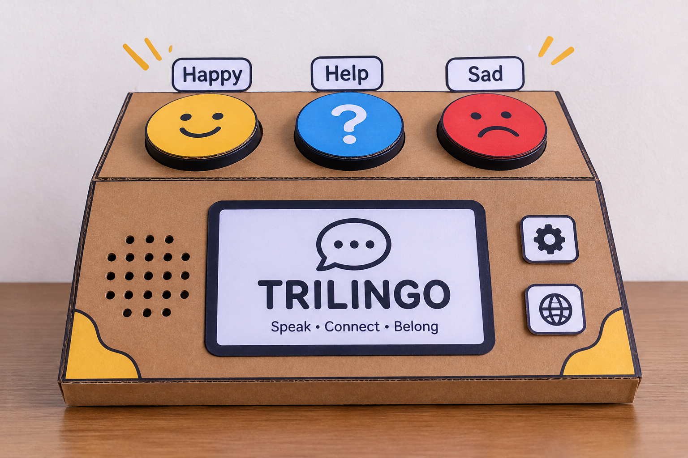

# TRILINGO

  

<h3 align="center">A voice, a button, a way to communicate.</h3>

  A simple communication device designed to help children express themselves through physical buttons and recorded messages.

---

## What is TRILINGO?

TRILINGO is a small, physical communication device built around one simple idea: making communication easier.

Press a button, and TRILINGO plays a recorded voice message. No complicated menus or typing required.

It is designed to support three languages:

- 🇲🇦 Moroccan Darija
- 🇫🇷 French
- 🇬🇧 English

## How it works

1. Press one of the large physical buttons.
2. The ESP32 identifies the selected button.
3. The firmware selects the corresponding audio recording.
4. The speaker plays the message.

## Inside the device

The planned electronics are based on a custom-designed PCB.

- **ESP32-WROOM-32E** — Main controller
- **Physical buttons** — User input
- **MicroSD card** — Stores recorded messages
- **Audio amplifier** — Drives the speaker
- **Speaker** — Plays voice messages
- **Rechargeable battery** — Powers the device

No complete development boards or ready-made audio modules are planned for the final custom PCB.

## Current progress

TRILINGO is a work in progress.

The 3D product concept is designed, while the custom PCB, schematic, firmware and hardware integration are still being developed.

## The goal

Create something simple, affordable and accessible that helps people communicate one message at a time.

---

  **TRILINGO — Every button has a voice.**

